<div align="center">
  
</div>


<p align="center">
  
</p>


<p>
  
  
  
</p>

</div>

---

# 👾 whoami

```python
class TharikProfile:

    name = "Mohamed Tharik S"

    role = [
        "Information Technology Student",
        "Cybersecurity Enthusiast",
        "Java Developer",
        "SOC Analyst Intern"
    ]

    college = "K. Ramakrishnan College of Engineering"

    degree = "B.Tech Information Technology"

    batch = "2024 - 2028"

    current_year = "Pre-Final Year"

    location = "Tamil Nadu, India"

    interests = [
        "Cybersecurity",
        "Security Operations",
        "Network Security",
        "Cloud Security",
        "Data Structures & Algorithms",
        "Software Development"
    ]

    currently_learning = [
        "Core Java",
        "Data Structures & Algorithms",
        "Cybersecurity",
        "Networking",
        "Security Operations"
    ]

    internship = "SOC Analyst @ HabileSec India Pvt. Ltd."
```

---

# ⚡ Current Status

```text
╔══════════════════════════════════════╗
║             SYSTEM STATUS            ║
╠══════════════════════════════════════╣
║ Name       : Mohamed Tharik S        ║
║ Status     : Learning & Building     ║
║ Education  : B.Tech Information Tech ║
║ Focus      : Cybersecurity           ║
║ Internship : SOC Analyst             ║
║ Language   : Java                    ║
║ Practice   : Data Structures & Algo  ║
║ Projects   : Kallvettu               ║
╚══════════════════════════════════════╝
```

---

# 🎓 Education

**K. Ramakrishnan College of Engineering**

- Degree: Bachelor of Technology – Information Technology
- Duration: August 2024 – May 2028
- Location: Tamil Nadu, India

**St. Marcina's Matric Higher Secondary School**

- Stream: Mathematics & Computer Science
- Duration: June 2023 – May 2024
- Grade: 83.5%

---

# 💼 Experience

### 🛡️ Security Operations Center Analyst

**HabileSec India Private Limited**

`August 2026 – September 2026`

- Cybersecurity internship experience.
- Exposure to Security Operations Center (SOC) activities.
- Learning cybersecurity practices and industry technologies.

---

# ⚔️ Tech Arsenal

<div align="center">

### 💻 Programming Languages


### 🌐 Web Technologies


### 🗄️ Database


### 🛡️ Cybersecurity & Operating Systems


### ⚙️ Development Tools


</div>

---

# 🧠 Cybersecurity Interests

```text
╔══════════════════════════════════════════╗
║           SECURITY INTERESTS             ║
╠══════════════════════════════════════════╣
║ ✔ Security Operations Center (SOC)       ║
║ ✔ Cybersecurity                          ║
║ ✔ Network Security                       ║
║ ✔ Cloud Security                         ║
║ ✔ Vulnerability Assessment               ║
║ ✔ Security Monitoring                    ║
║ ✔ Data Structures & Algorithms           ║
║ ✔ Secure Software Development            ║
╚══════════════════════════════════════════╝
```

---

  <h3>🎮 MY PIXEL STUDIO</h3>

  


# 🚀 Featured Projects

<table>
<tr>
<td width="50%" valign="top">

## 🏛️ Kallvettu

**Ancient Inscription Restoration & Translation Platform**

An epigraphical computer vision and Classical Tamil NLP platform designed to restore, decipher and translate ancient South Indian stone inscriptions.

### ✨ Features

- Digital inscription restoration
- Ancient Tamil script recognition
- Multi-engine OCR integration
- Tamil and English translation
- Historical and lexical analysis
- Research dossier generation
- Evidence-based transcription verification

### ⚙️ Tech Stack

`Python` `Streamlit` `OpenCV`

`PaddleOCR` `Gemini AI` `Sarvam AI`

### 🔗 Repository

[View Kallvettu →](https://github.com/tharik1305/Kallvettu)

</td>
<td width="50%" valign="top">

## ☕ IT Java Training

**Java Programming Practice Repository**

A collection of Java programming exercises and implementations developed while learning Java fundamentals and problem-solving.

### ✨ Implementations

- Binary Search
- Binary Search Insert Position
- Array Operations
- Conditional Array Sum
- Ceil and Floor Functions
- Butterfly Pattern Printing

### ⚙️ Technologies

`Java` `Core Java`

`Algorithms` `Problem Solving`

### 🔗 Repository

[View IT-Java-training →](https://github.com/tharik1305/IT-Java-training)

</td>
</tr>
</table>

---

# 📚 Currently Learning

```text
████████████████████████████████

→ Core Java
→ Data Structures & Algorithms
→ Cybersecurity Fundamentals
→ Network Security
→ Cloud Security
→ Security Operations
→ Problem Solving

████████████████████████████████
```

---

# 🎯 Career Goals

- Strengthen Data Structures and Algorithms.
- Develop strong Java programming fundamentals.
- Gain practical cybersecurity experience.
- Explore SOC operations and security monitoring.
- Build meaningful software and cybersecurity projects.
- Continuously improve through hands-on learning.

---

# 📊 GitHub Analytics

<div align="center">


</div>

---

<h2 align="center">📺 MY GITHUB TELEVISION</h2>

<div align="center">
  
  <br/>
  <sub>📡 TUNING INTO MY DIGITAL WORLD</sub>
</div>

# 🐍 Contribution Snake

<div align="center">

<picture>
  <source media="(prefers-color-scheme: dark)" srcset="https://raw.githubusercontent.com/tharik1305/tharik1305/output/github-snake-dark.svg"/>
  <source media="(prefers-color-scheme: light)" srcset="https://raw.githubusercontent.com/tharik1305/tharik1305/output/github-snake.svg"/>
  
</picture>

</div>

---

 <h3>🏙️ MY DIGITAL CITY</h3>

  

  <br/><br/>


# 🌐 Connect With Me

<div align="center">

<a href="https://www.linkedin.com/in/mohamed-tharik-s-2b5b73351/">

</a>

<a href="https://github.com/tharik1305">

</a>

</div>

---

<div align="center">

### 💬 Favorite Quote

> "The more you learn, the more you realize how much there is to explore."

**⚡ Keep Learning • Keep Building • Keep Securing**


</div>
